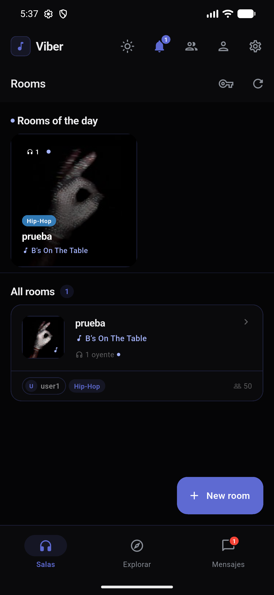
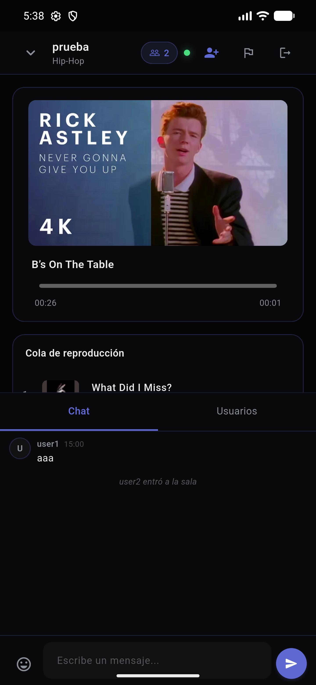
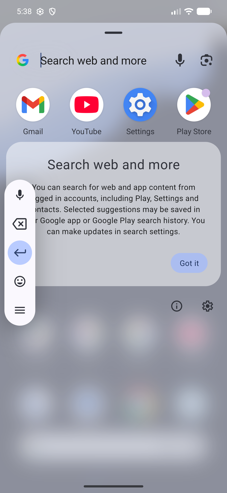
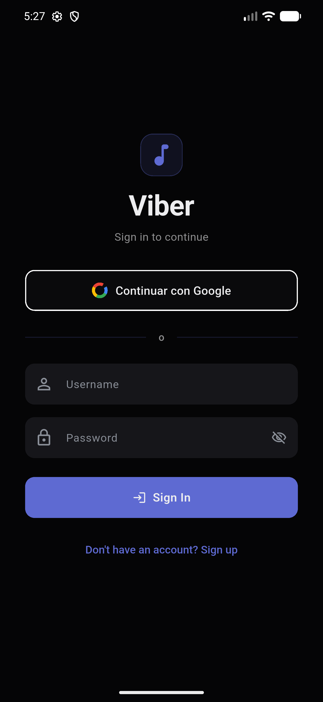
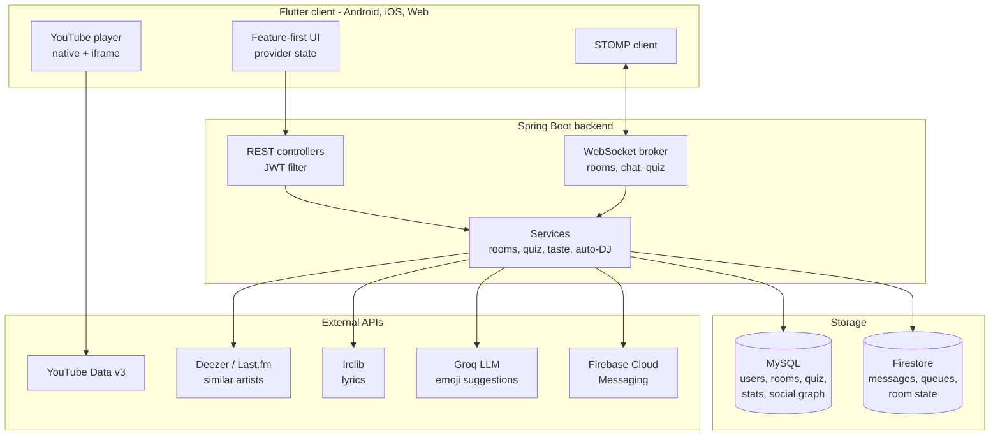

<div align="center">


# Viber

**Listen to music together, in real time.**

Create a room, queue songs, and everyone hears the same second of the same track —
with chat, live music quizzes, and rooms that keep playing on their own.

[](https://github.com/J1nnzz/viber/actions/workflows/backend.yml)
[](https://github.com/J1nnzz/viber/actions/workflows/frontend.yml)

[](https://flutter.dev)
[](https://spring.io/projects/spring-boot)
[](https://openjdk.org)
[](https://www.mysql.com)
[](https://firebase.google.com/products/firestore)


</div>

---

## The idea

Sharing music over chat is broken. You paste a link, the other person opens it
whenever, and you end up describing a song instead of listening to it together.

Viber makes listening a shared, synchronous activity. A room has one playback
position that the server owns, so everyone in it is at the same second — join
halfway through a track and you land exactly where the room is. Around that core
there is a queue anyone can add to, chat, friends, groups, and a competitive
music quiz to play while you listen.

## Screenshots

> **Note:** these captures predate the June 2026 rebrand and the group, quiz,
> recommendation and auto-DJ features. Fresh ones are on the list.

<div align="center">




</div>

## Features

**Shared listening**
- Server-authoritative playback: one position per room, pushed over WebSockets.
  Late joiners are seeked to the room's current second.
- Collaborative queue — anyone in the room can add tracks, everyone sees it update live.
- Public and private rooms, per-genre tagging, live listener counts and presence.
- **Permanent rooms with auto-DJ**: rooms that never go quiet. When the queue drops
  below a threshold the server picks the next track itself from a similar-artist graph.

**Social**
- Friends, direct messages, and group chats with roles and per-role permissions.
- Profiles with listening stats, liked songs, and a ranking.
- Push notifications via Firebase Cloud Messaging.

**Music quiz**
- Live Kahoot-style matches over WebSockets, plus a daily solo mode.
- Four clue modes: `CLASSIC` (feedback grid per guess), `AUDIO` (a longer snippet
  each attempt), `LYRICS` (one more line of the lyrics each attempt) and `EMOJI`
  (one more emoji each attempt).
- Emoji clues are curated by admins, with an LLM-assisted suggestion step.

**Discovery**
- Room recommendations ranked by how well a room matches your taste.
- Explore feed, search, and genre browsing.

**Platform**
- Runs on Android, iOS and the web from one Flutter codebase.
- Light and dark themes, dark-first, with the accent colour adapting per mode.
- Full Spanish and English localisation.
- Admin panel for the quiz catalogue and moderation.

## Architecture



**Why two datastores.** MySQL holds the relational core — users, rooms, the social
graph, the quiz catalogue, stats. Firestore holds the high-churn, append-heavy data
where its realtime listeners pay off: chat messages, playback queues, and live room
state. The split keeps chat traffic off the relational database.

## Two problems worth a closer look

### Room recommendation without collaborative filtering

Rooms are ranked by cosine similarity between a user's taste vector and each
room's genre/artist vector. The design constraint was deliberate: **no
collaborative filtering and no ML model.** A brand-new product has no user-user
signal to mine, so anything based on other people's behaviour is dead on arrival.

Instead, taste is built from the user's own listening events, weighted by an
exponential time decay with a configurable half-life (14 days by default), so
last week's rock beats last year's hip-hop. It is deterministic, explainable, and
works correctly for user number one. Empty profile? Every affinity is zero and the
tiebreak on listener count surfaces the busiest rooms — a sane fallback while
there is nothing to learn from.

### Keeping a room playing with nobody in it

Permanent rooms use an auto-DJ. A scheduled scan checks whether the queue has
fallen below a minimum depth and, if so, enqueues a track chosen from a
similar-artist graph built from Deezer, optionally enriched with Last.fm, with an
LLM as a last resort. A tunable probability decides whether to stay with the same
artist or jump to a neighbour, which keeps a room coherent without it looping the
same three songs.

## Tech stack

| Layer | Choices |
|---|---|
| **Client** | Flutter (Dart SDK 3.11), feature-first structure, `provider` for state, `stomp_dart_client`, `youtube_player_flutter` on mobile + `youtube_player_iframe` on web, `easy_localization`, `flutter_secure_storage`, `just_audio` |
| **Backend** | Spring Boot 4.0 on Java 25, Spring WebMVC + WebSocket (STOMP), Spring Security, Spring Data JPA, JJWT, springdoc OpenAPI |
| **Data** | MySQL 8 (utf8mb4), Cloud Firestore |
| **Auth** | JWT bearer tokens, Google Sign-In on mobile and web |
| **External** | YouTube Data API v3, Deezer, Last.fm, lrclib, Groq (Llama 3.3 70B), Firebase Cloud Messaging |
| **Promo** | Remotion (React) for the trailer |

## Getting started

### Prerequisites

- JDK 25+
- Flutter 3.11+ with the Dart SDK
- MySQL 8
- A Firebase project (Firestore + Cloud Messaging)
- A Google Cloud project with the YouTube Data API v3 enabled

### 1. Database

```sql
CREATE DATABASE viber_db CHARACTER SET utf8mb4 COLLATE utf8mb4_unicode_ci;
```

The `utf8mb4` collation is not optional — the quiz's emoji mode stores surrogate
pairs, and a `latin1` connection silently turns them into `??`.

Hibernate creates the schema on first run (`ddl-auto=update`).

### 2. Backend configuration

No secrets are committed. Copy the template and fill in your own keys:

```bash
cd viber_backend/src/main/resources
cp application-local.properties.example application-local.properties
```

`application-local.properties` is gitignored and overrides the base config,
because the `local` profile is active by default. In production, set the
equivalent environment variables instead (`DB_PASSWORD`, `JWT_SECRET`,
`YOUTUBE_API_KEY`, `GROQ_API_KEY`, `GOOGLE_CLIENT_ID`, …) and run with
`SPRING_PROFILES_ACTIVE=prod`.

Firebase credentials are not in the repo either. Download the service account
JSON from Firebase Console → Project settings → Service accounts and save it to
`viber_backend/src/main/resources/serviceAccountKey.json`, or point
`FIREBASE_CREDENTIALS` somewhere else. See [FIREBASE_PUSH_SETUP.md](FIREBASE_PUSH_SETUP.md).

### 3. Run the backend

```bash
cd viber_backend
./mvnw spring-boot:run
```

API docs land on `http://localhost:8080/swagger-ui/index.html`.

### 4. Run the client

```bash
cd viber_frontend
flutter pub get
flutter run           # mobile
flutter run -d chrome # web
```

The web build talks to `localhost:8080` and mobile builds default to `10.0.2.2`,
the Android emulator's alias for the host machine. On a **physical device**
neither applies — the phone has its own `localhost` — so pass your machine's LAN
address at build time:

```bash
flutter run --dart-define=VIBER_API_HOST=http://192.168.1.42:8080
```

The same flag works for `flutter build apk`. Nothing about the host is hardcoded
in the source.

For an Android build, add your own `google-services.json` to
`viber_frontend/android/app/` — see the `.example` file next to it. The web build
and the backend work without it.

## Repository layout

```
viber_backend/    Spring Boot API, WebSocket broker and services
viber_frontend/   Flutter client (lib/features/* — feature-first)
viber-promo/      Remotion project for the promo video
docs/             Screenshots and documentation assets
```

Backend packages follow `controller / service / repository / model / dto / config`.
Client features each own their `presentation`, `infrastructure` and models —
`auth`, `rooms`, `chat`, `groups`, `quiz`, `social`, `youtube`, `notifications`,
`admin` — with shared theming, widgets and services under `lib/core`.

## Roadmap

- [ ] Fresh screenshots and a trailer in the README
- [ ] CI running the backend and Flutter test suites
- [ ] `docs/ARCHITECTURE.md` with the sync protocol in detail
- [ ] Deploy to Oracle Cloud Free Tier
- [ ] Rotate `jwt.secret` off its inherited placeholder before any public deployment

## Notes

Viber started as a second-year DAM coursework project and is now built as a real
product. The name collides with Rakuten Viber, the messaging app — it is a working
title, not a trademark claim.

Music playback is handled by the official YouTube player, so playback and
monetisation stay with the original rights holders. The promo video's audio track
is not included in this repository for the same reason.
